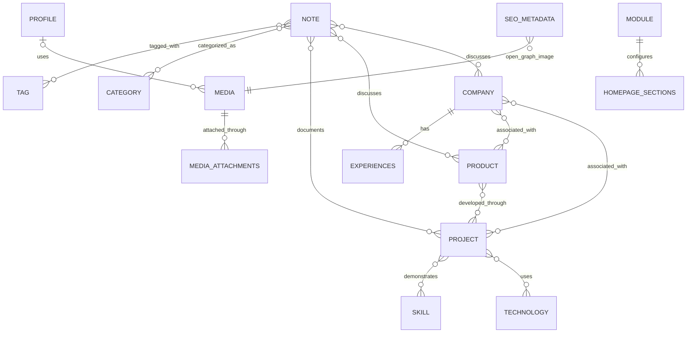

# Detailed ERD & Database Schema v1.0 — hosseinyariam.ir

**Status:** Draft for technical review  
**Stack:** Laravel 12, PHP 8.4, MySQL  
**Architecture:** Modular Monolith  
**Language strategy:** Persian first; English-ready  
**Purpose:** تبدیل Domain Model به طرح دیتابیس قابل پیاده‌سازی، پیش از ساخت Migrationها.

> این سند مبنای طراحی است، نه مجوز اجرای کورکورانه Migration روی دیتابیس Production. پیش از اجرا باید با ساختار فعلی پروژه، نسخه MySQL هاست و داده‌های موجود تطبیق داده شود.

---

## 1. اصول طراحی

1. `Company`, `Product`, `Project` موجودیت‌های مستقل هستند.
2. روابط بین این سه موجودیت اختیاری‌اند؛ رابطه چندبه‌چند فقط با جدول واسط صریح پیاده‌سازی می‌شود.
3. وضعیت کاری (`status`) با وضعیت انتشار (`publication_status` یا `visibility`) یکی نیست.
4. محتوای مستقل با حذف یک رابطه نباید حذف شود.
5. کلیدهای خارجی و ایندکس‌ها باید در دیتابیس تعریف شوند، نه فقط در منطق برنامه.
6. برای محتوای عمومی، آرشیو کردن معمولاً بر حذف دائمی ترجیح دارد.
7. ترجمه و SEO باید از داده‌های اصلی قابل تفکیک باشند.
8. از ساخت یک جدول عمومی برای تمام انواع محتوا اجتناب می‌شود.

## 2. قراردادهای مشترک

برای جدول‌های محتوایی که صفحه مستقل دارند، حسب نیاز:

- `id BIGINT UNSIGNED PRIMARY KEY`
- `slug VARCHAR(180)` با unique index در همان جدول
- `summary VARCHAR(500) NULL`
- `description LONGTEXT NULL`
- `publication_status VARCHAR(20)`؛ مقادیر پیشنهادی: `draft`, `private`, `public`, `archived`
- `is_featured BOOLEAN NOT NULL DEFAULT FALSE`
- `published_at DATETIME NULL`
- `created_at`, `updated_at`
- `deleted_at` فقط برای جدول‌هایی که Soft Delete واقعاً لازم دارند

از افزودن همه این ستون‌ها به هر جدول خودداری شود؛ فیلدهای مشترک فقط جایی اضافه شوند که کاربرد دارند.

## 3. جدول‌ها

### 3.1 Identity & Admin

#### `users`
- `id`
- `name`
- `email` UNIQUE
- `password`
- `is_active` BOOLEAN DEFAULT TRUE
- `email_verified_at` NULL
- `remember_token` NULL
- timestamps

#### `profiles`
نسخه اول می‌تواند یک رکورد اصلی داشته باشد؛ این محدودیت در سطح Application enforce شود، مگر آنکه نیاز واقعی به چند پروفایل وجود داشته باشد.
- `id`
- `name`
- `professional_title`
- `short_bio` TEXT NULL
- `biography` LONGTEXT NULL
- `philosophy` TEXT NULL
- `values` JSON NULL
- `profile_image_id` FK NULL → `media.id`
- timestamps

### 3.2 Companies, Products, Projects

#### `companies`
- `id`
- `name`
- `slug` UNIQUE
- `summary` VARCHAR(500) NULL
- `description` LONGTEXT NULL
- `website_url` VARCHAR(2048) NULL
- `company_type` VARCHAR(40) NULL
- `relationship_to_hossein` VARCHAR(60) NULL
- `start_date` DATE NULL
- `end_date` DATE NULL
- `operational_status` VARCHAR(30) DEFAULT `active`
- `publication_status` VARCHAR(20) DEFAULT `draft`
- `is_featured` BOOLEAN DEFAULT FALSE
- timestamps

#### `products`
- `id`
- `name`
- `slug` UNIQUE
- `summary` VARCHAR(500) NULL
- `description` LONGTEXT NULL
- `problem` LONGTEXT NULL
- `solution` LONGTEXT NULL
- `website_url` VARCHAR(2048) NULL
- `product_status` VARCHAR(30) DEFAULT `idea`
- `started_at` DATE NULL
- `launched_at` DATE NULL
- `publication_status` VARCHAR(20) DEFAULT `draft`
- `is_featured` BOOLEAN DEFAULT FALSE
- timestamps

#### `projects`
- `id`
- `title`
- `slug` UNIQUE
- `summary` VARCHAR(500) NULL
- `description` LONGTEXT NULL
- `problem` LONGTEXT NULL
- `context` LONGTEXT NULL
- `role` TEXT NULL
- `contribution` LONGTEXT NULL
- `outcome` LONGTEXT NULL
- `lessons_learned` LONGTEXT NULL
- `project_status` VARCHAR(30) DEFAULT `planned`
- `start_date` DATE NULL
- `end_date` DATE NULL
- `publication_status` VARCHAR(20) DEFAULT `draft`
- `is_featured` BOOLEAN DEFAULT FALSE
- timestamps

#### Relationship pivot tables
All pivot tables have an `id` only if later required; otherwise composite unique constraints are sufficient. Recommended baseline:

- `company_product`: `company_id`, `product_id`, `relationship_type` NULL, timestamps; UNIQUE (`company_id`, `product_id`)
- `company_project`: `company_id`, `project_id`, `relationship_type` NULL, timestamps; UNIQUE (`company_id`, `project_id`)
- `product_project`: `product_id`, `project_id`, `relationship_type` NULL, timestamps; UNIQUE (`product_id`, `project_id`)

FKs use `ON DELETE CASCADE` for the pivot rows only; the company/product/project records themselves are not cascaded through these pivots.

### 3.3 Professional History

#### `experiences`
- `id`
- `title`
- `employment_type` VARCHAR(40) NULL
- `company_id` FK NULL → `companies.id`
- `description` LONGTEXT NULL
- `start_date` DATE NULL
- `end_date` DATE NULL
- `is_current` BOOLEAN DEFAULT FALSE
- `sort_order` INT DEFAULT 0
- `publication_status` VARCHAR(20) DEFAULT `draft`
- timestamps

#### `education`
- `id`
- `institution`
- `degree` VARCHAR(150) NULL
- `field_of_study` VARCHAR(180) NULL
- `description` TEXT NULL
- `start_date` DATE NULL
- `end_date` DATE NULL
- `sort_order` INT DEFAULT 0
- `publication_status` VARCHAR(20) DEFAULT `draft`
- timestamps

#### `skills`
- `id`
- `name`
- `slug` UNIQUE
- `description` TEXT NULL
- `category` VARCHAR(100) NULL
- timestamps

#### `technologies`
- `id`
- `name`
- `slug` UNIQUE
- `description` TEXT NULL
- `official_url` VARCHAR(2048) NULL
- timestamps

#### `achievements`
- `id`
- `title`
- `description` TEXT NULL
- `achieved_at` DATE NULL
- `evidence_url` VARCHAR(2048) NULL
- `publication_status` VARCHAR(20) DEFAULT `draft`
- timestamps

#### `certificates`
- `id`
- `title`
- `issuer`
- `issued_at` DATE NULL
- `expires_at` DATE NULL
- `credential_url` VARCHAR(2048) NULL
- `publication_status` VARCHAR(20) DEFAULT `draft`
- timestamps

#### Skill/technology pivots
- `project_skill`: `project_id`, `skill_id`; UNIQUE pair
- `project_technology`: `project_id`, `technology_id`; UNIQUE pair

### 3.4 Notes & Taxonomy

#### `notes`
- `id`
- `title`
- `slug` UNIQUE
- `excerpt` TEXT NULL
- `body` LONGTEXT
- `content_type` VARCHAR(40)
- `publication_status` VARCHAR(20) DEFAULT `draft`
- `published_at` DATETIME NULL
- `is_featured` BOOLEAN DEFAULT FALSE
- timestamps

Allowed `content_type` values should be validated in application code, initially:
`article`, `technical_note`, `experience`, `lesson`, `product_story`.

#### `categories`
- `id`
- `name`
- `slug` UNIQUE
- `description` TEXT NULL
- timestamps

#### `tags`
- `id`
- `name`
- `slug` UNIQUE
- timestamps

#### Note relationships
- `note_tag`: `note_id`, `tag_id`; UNIQUE pair
- `note_category`: `note_id`, `category_id`; UNIQUE pair
- `note_project`: `note_id`, `project_id`; UNIQUE pair
- `note_product`: `note_id`, `product_id`; UNIQUE pair
- `note_company`: `note_id`, `company_id`; UNIQUE pair

### 3.5 Timeline & Current Focus

#### `timeline_events`
- `id`
- `title`
- `description` TEXT NULL
- `event_type` VARCHAR(40)
- `start_date` DATE NULL
- `end_date` DATE NULL
- `is_highlight` BOOLEAN DEFAULT FALSE
- `publication_status` VARCHAR(20) DEFAULT `draft`
- `sort_order` INT DEFAULT 0
- timestamps

#### `current_focuses`
- `id`
- `title`
- `description` TEXT NULL
- `focus_type` VARCHAR(30)
- `priority` SMALLINT DEFAULT 0
- `start_date` DATE NULL
- `end_date` DATE NULL
- `is_active` BOOLEAN DEFAULT TRUE
- `publication_status` VARCHAR(20) DEFAULT `draft`
- timestamps

For focus targets, prefer explicit nullable FKs such as `project_id`, `product_id`, `company_id`, `note_id` if only a small stable set of target types is required. This gives real database constraints. Use a polymorphic target only if the target types are expected to expand often and the integrity trade-off is accepted.

For timeline links, either explicit nullable FKs or a polymorphic relation can work. Initial recommendation: `timeline_eventables` polymorphic pivot only if multiple targets per event are a real requirement; otherwise use explicit FK tables.

### 3.6 Media, SEO, Contact & Presentation

#### `media`
- `id`
- `disk` VARCHAR(40)
- `path` VARCHAR(2048)
- `original_name` VARCHAR(255) NULL
- `mime_type` VARCHAR(150)
- `size_bytes` BIGINT UNSIGNED
- `alt_text` VARCHAR(255) NULL
- `caption` TEXT NULL
- `metadata` JSON NULL
- timestamps

Do not store binary file contents in MySQL; store file paths and metadata.

#### Media attachments
Recommended initial design: polymorphic `media_attachments`:
- `id`
- `media_id` FK → `media.id`
- `mediable_type`
- `mediable_id`
- `collection` VARCHAR(60) DEFAULT `default`
- `sort_order` INT DEFAULT 0
- timestamps
- index (`mediable_type`, `mediable_id`)
- index (`media_id`)

Use only trusted internal model types; do not accept arbitrary client-supplied morph class names.

#### `seo_metadata`
- `id`
- `seoable_type`
- `seoable_id`
- `meta_title` VARCHAR(255) NULL
- `meta_description` VARCHAR(320) NULL
- `canonical_url` VARCHAR(2048) NULL
- `robots` VARCHAR(100) NULL
- `og_title` VARCHAR(255) NULL
- `og_description` VARCHAR(320) NULL
- `og_image_id` FK NULL → `media.id`
- timestamps
- UNIQUE (`seoable_type`, `seoable_id`)

Polymorphic SEO rows do not have a conventional FK to every content table; the application must maintain referential integrity when deleting or changing content.

#### `contact_channels`
- `id`
- `type` VARCHAR(40)
- `label` VARCHAR(100)
- `url` VARCHAR(2048)
- `is_public` BOOLEAN DEFAULT TRUE
- `sort_order` INT DEFAULT 0
- timestamps

#### `modules`
- `id`
- `key` VARCHAR(100) UNIQUE
- `name` VARCHAR(150)
- `is_enabled` BOOLEAN DEFAULT TRUE
- `configuration` JSON NULL
- `sort_order` INT DEFAULT 0
- timestamps

#### `homepage_sections`
- `id`
- `key` VARCHAR(100) UNIQUE
- `module_key` VARCHAR(100) NULL
- `is_enabled` BOOLEAN DEFAULT TRUE
- `sort_order` INT DEFAULT 0
- `selection_mode` VARCHAR(20) DEFAULT `automatic`
- `configuration` JSON NULL
- timestamps

`module_key` references a stable module key at application level; if module keys are stored in a mutable table, decide whether to add a real FK or use a stable code registry.

#### `settings`
- `id`
- `key` VARCHAR(150) UNIQUE
- `value` LONGTEXT NULL
- `type` VARCHAR(40) DEFAULT `string`
- `is_encrypted` BOOLEAN DEFAULT FALSE
- timestamps

Sensitive AI credentials should use Laravel encryption and never be exposed in frontend responses. Prefer a dedicated AI configuration table if multiple providers/environments will be configured.

### 3.7 Translation strategy

For the first release, keep Persian as the only published language, but make the architecture English-ready.

Recommendation: use translation tables for content that needs translation rather than adding `title_en`, `title_fa`, etc. to every entity.

Example `note_translations`:
- `id`
- `note_id` FK → `notes.id`
- `locale` VARCHAR(10)
- `title` VARCHAR(255)
- `slug` VARCHAR(180)
- `excerpt` TEXT NULL
- `body` LONGTEXT
- `publication_status` VARCHAR(20) DEFAULT `draft`
- `published_at` DATETIME NULL
- timestamps
- UNIQUE (`note_id`, `locale`)
- UNIQUE (`locale`, `slug`)

Use analogous translation tables only for entities whose public text must be localized. Do not build a generic translation engine for every field unless requirements justify its complexity. The main `slug` policy should be finalized: either default-language slug lives in the base table or all locale-specific slugs live in translation tables. Avoid storing the same slug in both places without a clear rule.

### 3.8 AI configuration

If only one provider is needed initially, `settings` may store a small number of non-secret settings, with the API key encrypted. If multiple providers are expected, use:

`ai_providers`
- `id`
- `name`
- `provider_key`
- `base_url` NULL
- `model` NULL
- `api_key_encrypted` TEXT NULL
- `is_enabled` BOOLEAN DEFAULT FALSE
- `configuration` JSON NULL
- timestamps

Never send `api_key_encrypted` to Blade templates or public endpoints. Decryption must occur only in the backend service when needed.

## 4. Foreign-key deletion policy

- Pivot rows: cascade when either linked record is deleted.
- `experiences.company_id`: `SET NULL`.
- `profiles.profile_image_id` and `seo_metadata.og_image_id`: `SET NULL`.
- Content references: normally restrict hard delete or use soft-delete/archive.
- Polymorphic references: clean up in application service/observer/transaction; database cannot enforce an FK to multiple target tables.
- Admin user deletion: do not cascade-delete authored content by default.

## 5. Indexing

Minimum indexes:
- Unique index on each table's `slug` where present.
- Index on all foreign-key columns.
- Index on `publication_status`, `published_at`, `is_featured` where used in public queries.
- Composite index for common listings, e.g. (`publication_status`, `published_at`).
- Unique pair indexes on pivot tables.
- Index (`mediable_type`, `mediable_id`) for polymorphic media attachments.
- Unique (`seoable_type`, `seoable_id`) for SEO metadata.
- Unique (`locale`, `slug`) for translated routes.

Avoid adding indexes to every column without query evidence.

## 6. Important unresolved decisions before migrations

1. Whether `TimelineEvent` can link to multiple entities or just one primary target.
2. Whether each `CurrentFocus` needs a relation to a project/product or may be free-standing.
3. Translation policy for slugs and public routes.
4. Whether the CMS needs multiple admin roles or one admin account initially.
5. Whether AI configuration needs multiple providers in the first release.
6. How to migrate existing tables/data in the current Laravel app, including `platforms` and `settings`.

## 7. Implementation order

1. Inspect the current Laravel migrations and production schema before making changes.
2. Approve the ERD and resolve the open decisions above.
3. Create migrations in dependency order.
4. Add Eloquent models, relationships, casts and policies.
5. Add factories and tests for relationships, uniqueness, deletion behavior and publication rules.
6. Seed baseline settings/modules and admin account safely.
7. Run migrations against a local/staging database first.
8. Back up production before applying any migration.

## 8. ERD summary

The diagram is intentionally a summary; pivot tables and polymorphic relations are specified in the table definitions above.

## 9. Next stage

**Laravel Models & Migration Blueprint**

Before writing migrations, inspect the repository's existing migrations and production data model. This project already has existing site data and must be evolved safely rather than rebuilt destructively.
