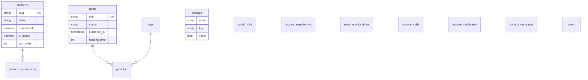

# سند نیازمندی‌های محصول (PRD)
## hosseinyariam.ir — برند شخصی و زیرساخت ویترین پلتفرم‌ها

| مشخصه | مقدار |
|---|---|
| نام محصول | hosseinyariam.ir |
| نوع سند | PRD نسخه‌ی ۱.۰ (تأییدشده برای توسعه) |
| مالک محصول | حسین یاری باباجان |
| نقش‌های سند | مدیر محصول، معمار نرم‌افزار، توسعه‌دهنده (تک‌نفره) |
| استک پیاده‌سازی | HTML / CSS / JavaScript / PHP 8.2+ / Laravel 11 / MySQL 8 |
| پنل مدیریت | Laravel Filament 3 |
| دیزاین‌سیستم | UI Kit «گلس روشن» پیوست‌شده (Light Glass) |
| دامنه‌ی مرجع | hosseinyariam.ir · vinora.hosseinyariam.ir |
| وضعیت | Final — آماده‌ی اجرا |

---

## فهرست
۱. خلاصه‌ی اجرایی — این محصول چیست
۲. چشم‌انداز و اهداف محصولی
۳. ارزش‌های محصول
۴. مخاطبان و پرسوناها
۵. محدوده (In / Out / Deferred)
۶. ماژول‌ها و بخش‌های محصول + User Stories و معیار پذیرش
۷. استانداردهای حاکم بر این PRD
۸. دیزاین‌سیستم — UI Kit و نگاشت آن به پیاده‌سازی
۹. معماری فنی
۱۰. مدل مفهومی داده (مرور)
۱۱. نیازمندی‌های غیرعملکردی (NFR)
۱۲. سنجه‌های موفقیت (KPI)
۱۳. ریسک‌ها و کاهش‌دهنده‌ها
۱۴. **برنامه‌ریزی توسعه‌ی فازبندی‌شده (بخش اصلی)**
۱۵. مایل‌استون‌ها و خط زمانی
۱۶. ماتریس ردیابی
پیوست الف: گزارش تصمیم‌ها (Decision Log)
پیوست ب: نگاشت داده ← پنل ← رفتار حالت خالی

---

# ۱. خلاصه‌ی اجرایی — این محصول چیست؟

**در یک جمله:** hosseinyariam.ir یک وب‌سایت شخصیِ مبتنی بر Laravel است که هم‌زمان نقش **برند شخصی** (معرفی، رزومه، وبلاگ فنی) و نقش **زیرساخت ویترین محصولات نرم‌افزاری واقعی** را ایفا می‌کند؛ جایی که افزودن پلتفرم بعدی، به‌جای پروژه‌ی کدنویسی جدید، فقط یک رکورد در پنل مدیریت است.

**توصیف کامل:**
این محصول یک مونولیت Laravel است که روی هاست اشتراکی cPanel اجرا می‌شود و از الگوی «هاب» پیروی می‌کند: سایت اصلی فقط **ویترین و نقطه‌ی اتصال** است؛ خود پلتفرم‌ها (مانند وینورا) اپلیکیشن‌های مستقلِ زیر زیردامنه هستند و از سایت اصلی فقط معرفی و لینک می‌شوند. تمام محتوای نمایشی — از بیو و رزومه تا کیس‌استادی پلتفرم‌ها — از پایگاه داده خوانده می‌شود و از پنل Filament وارد می‌گردد؛ **هیچ داده‌ی محتوایی در کد قرار نمی‌گیرد**.

سه مخاطب هم‌وزن دارد: کارفرما (فرصت شغلی)، مشتری خدمات نرم‌افزاری (مشاوره/سفارش) و شبکه‌ی حرفه‌ای (اعتبار بلندمدت). در لحظه‌ی لانچ، **وینورا** (پلتفرم هوشمند سلامت تاکستان، زنده روی vinora.hosseinyariam.ir) اولین و تنها رکورد واقعی ویترین است و **تسکر** به‌صورت آگاهانه به بعد از تکمیل موکول شده است — سازوکار «افزودن پلتفرم بدون کد» مسیر بازگشت آن را باز نگه می‌دارد.

---

# ۲. چشم‌انداز و اهداف محصولی

**چشم‌انداز:**
تبدیل‌شدن hosseinyariam.ir به مرجع معتبر معرفی حسین یاری باباجان به‌عنوان توسعه‌دهنده‌ای که **محصول واقعی می‌سازد و اجرا می‌کند** — نقطه‌ی اتصال هم‌زمان برای فرصت‌های شغلی، مشتریان بالقوه‌ی خدمات نرم‌افزاری و شبکه‌ی حرفه‌ای بلندمدت.

**اهداف (هر سه هم‌وزن — این هم‌وزنی یک تصمیم قفل‌شده است، نه اولویت‌بندی):**

| # | هدف | مکانیزم اصلی در محصول |
|---|---|---|
| G1 | جذب فرصت شغلی | نمایش شفاف مهارت‌ها، رزومه‌ی قابل‌دانلود PDF، پروژه‌های واقعی (نه تمرینی) |
| G2 | جذب مشتری خدمات | هر پلتفرم = یک صفحه‌ی کیس‌استادی مستقل با مسیر تماس/درخواست مشاوره |
| G3 | برندسازی بلندمدت | یادداشت‌های فنی منظم با ریتم پایدار، زیرساخت آماده از روز اول |
| G4 | آماده برای رشد | معماری داده‌محور — پلتفرم جدید = رکورد + اسکرین‌شات، بدون کدنویسی صفحه‌ی جدید |

---

# ۳. ارزش‌های محصول

این پنج ارزش، عهدِ مشترک همه‌ی فازهاست. در **هر فاز** از بخش ۱۴، بلوک «ارزش‌ها در این فاز» به این جدول ارجاع می‌دهد.

| # | ارزش | تعریف عملیاتی | ممنوعیت |
|---|---|---|---|
| V1 | **سادگی درجه‌یک** | هر صفحه فقط به یک پرسش مخاطب پاسخ می‌دهد؛ حداکثر ۲ کلیک تا هر CTA | ویژگی تزئینی بدون هدف |
| V2 | **طراحی شهودی** | الگوهای آشنا، ناوبری پیش‌بینی‌پذیر، RTL بومی و بی‌نقص | جابه‌جایی الگو بین صفحات |
| V3 | **صداقت و اعتبار** | فقط پروژه‌ی واقعی، وضعیت واقعی، لینک زنده | ادعای بی‌مدرک، دیتای ساختگی |
| V4 | **رشد داده‌محور** | «محتوا از پنل، نه از کد» — تغییر برند/محتوا بدون دیپلوی | هاردکد محتوا در Blade/Config |
| V5 | **پایداری بلندمدت** | قابل‌نگهداشت توسط یک نفر؛ هزینه‌ی نگهداشت ماهانه ≤ چند ساعت | وابستگی به سرویس/پیچیدگی اضافه |

**قاعده‌ی سخت‌گیرانه (Hard Rule):** هر تصمیم طراحی که با V1 یا V4 در تضاد باشد، به‌صورت خودکار رد می‌شود — حتی اگر جذاب‌تر به‌نظر برسد.

---

# ۴. مخاطبان و پرسوناها

| پرسونا | نیاز اصلی | مسیر اصلی در سایت | سنجه‌ی موفقیت مربوطه |
|---|---|---|---|
| **کارفرما / رکروتر فنی** («سحر») | در ۳۰ ثانیه قضاوت: مهارت، سابقه، مدرکِ محصول واقعی | هیرو ← رزومه ← ویترین ← دانلود PDF | دانلود رزومه، تماس باکیفیت |
| **مشتری خدمات** («مدیر کسب‌وکار / استارتاپ») | اثبات قابلیت اجرای پروژه‌ی سفارشی | ویترین ← کیس‌استادی وینورا ← «درخواست مشاوره» | تماس باکیفیت (هدف service) |
| **هم‌حرفه / توسعه‌دهنده** («هم‌مسیر») | محتوای فنی معتبر، الگوی معماری | وبلاگ ← تک‌پست ← شبکه‌ی اجتماعی | بازدید یکتا، ریتم انتشار |
| **مدیر محتوا (خودِ حسین)** | ورود محتوا سریع، بدون کد | پنل Filament + ویجت «آمادگی محتوا» | صفر دیپلوی برای محتوای جدید |

---

# ۵. محدوده

### In Scope (فاز لانچ — ۵ هفته)
هویت و هیرو، ویترین پلتفرم‌ها (پویا از DB)، قالب اختصاصی پلتفرم، رکورد وینورا (seed)، رزومه (وب + PDF آپلودی)، فرم تماس، پنل Filament، زیرساخت کامل وبلاگ (مدل + پنل + صفحات با حالت خالی + RSS)، SEO، Matomo سلف‌هاست، استقرار روی هاست اشتراکی.

### Out of Scope (در هیچ فازی از v1 نیست)
- ادغام کدبیس پلتفرم‌ها در سایت اصلی (الگوی هاب قفل شده)
- کپچا (به‌جای آن honeypot + rate limit)، کامنت‌های وبلاگ، خبرنامه
- SPA / فریم‌ورک فرانت‌اند سنگین؛ CI/CD خودکار و VPS

### Deferred (آگاهانه موکول — بازگشت از مسیر تعریف‌شده)
| مورد | محرک بازگشت | مسیر بازگشت |
|---|---|---|
| **کیس‌استادی تسکر** | تکمیل تسکر | افزودن رکورد از پنل Filament — صفر خط کد (فاز ۸.۲) |
| تولید داینامیک PDF رزومه | تغییرات مکرر رزومه | اپیک مستقل فاز ۸.۳ |
| نسخه‌ی انگلیسی | فرصت بین‌المللی | معماری translation-ready از روز اول (فاز ۸.۴) |

---

# ۶. ماژول‌ها و بخش‌های محصول

شماره‌گذاری اپیک‌ها با جدول اصلی بریف منطبق است؛ اپیک ۴ طبق تصمیم قفل‌شده از «تسکر» به «رکورد وینورا» تغییر یافته.

### M1 — صفحه‌ی اصلی هویتی (اپیک ۱) · P1
**مسیر:** `/` — **مسئول پاسخ:** «این کیست، چه کار می‌کند و چه مدرکی دارد؟»

**بلاک‌ها:** هیرو (نام کوتاه «حسین یاری»، عنوان، بیوی کوتاه، چیپ تخصص‌ها)، پنل وضعیت (دسترسی برای پروژه + آمار)، تیزر پلتفرم شاخص (وینورا)، تیزر آخرین یادداشت (مشروط به وجود پست)، ردیف CTA (دانلود رزومه / تماس).

- **US-M1-1:** به‌عنوان کارفرما، می‌خواهم در ۳ ثانیه عنوان و حوزه‌ی تخصص را ببینم تا تصمیم بگیرم بمانم یا نه. *AC: عنوان و بیو در بالای اولین صفحه‌ی رندر بدون اسکرول دیده شود.*
- **US-M1-2:** به‌عنوان بازدیدکننده، می‌خواهم تیزر پلتفرم شاخص را ببینم تا مدرک «محصول واقعی» را فوراً ببینم. *AC: کارت وینورا با وضعیت زنده و لینک دمو در ابتدای صفحه.*
- **US-M1-3:** به‌عنوان بازدیدکننده، می‌خواهم CTA رزومه و تماس همیشه در دسترس باشد. *AC: در موبایل و دسکتاپ، هر دو CTA بدون اسکرول افقی قابل دسترسی‌اند؛ دکمه‌ی رزومه فقط وقتی PDF آپلود شده باشد رندر شود (وگرنه CTA تماس جایگزین شود).*

### M2 — ویترین پلتفرم‌ها (اپیک ۲) · P1
**مسیر:** `/platforms` — گرید کارت‌ها، کاملاً پویا از DB.

- **US-M2-1:** به‌عنوان بازدیدکننده، می‌خواهم همه‌ی پلتفرم‌های فعال را با وضعیت هرکدام ببینم. *AC (Gherkin):* فرض داده‌ی فعال موجود است؛ وقتی `/platforms` باز می‌شود؛ آنگاه کارت‌ها به‌ترتیب `sort_order` و فقط `is_active=true` رندر می‌شوند و نشان وضعیت (زنده/بتا/در توسعه/آرشیو) روی هر کارت هست.
- **US-M2-2:** به‌عنوان مدیر سایت، می‌خواهم پلتفرم جدید را بدون کدنویسی اضافه کنم. *AC: از پنل Filament، رکورد جدید با فیلدهای اختیاری + status + is_featured + ترتیب؛ صفحه عمومی بلافاصله (پس از پاک‌شدن کش) کارت جدید را نشان می‌دهد.*
- **US-M2-3:** حالت خالی. *AC: صفر رکورد فعال = کامپوننت Empty State با CTA به تماس، نه صفحه‌ی خالی مرده.*

### M3 — صفحه‌ی اختصاصی هر پلتفرم (اپیک ۳ + ۴) · P1
**مسیر:** `/platforms/{slug}` — قالب یکسانِ قابل‌استفاده‌ی مجدد؛ **اعتبارسنجی با وینورا**.

**بلاک‌ها:** سربرگ (کاشی آیکون + عنوان + تگ‌لاین + نشان وضعیت + دکمه‌ی «مشاهده‌ی دمو/لینک زنده» + «کد منبع» اختیاری)، سکشن مسئله/راه‌حل، لیست امکانات، گالری اسکرین‌شات، چیپ‌های استک فنی، جدول مشخصات (نسخه، لایسنس، به‌روزرسانی)، CTA پایانی «درخواست مشاوره برای محصول مشابه» (اتصال به M6 با purpose=service از پیش انتخاب‌شده).

- **US-M3-1:** به‌عنوان مشتری بالقوه، می‌خواهم مسئله‌ی حل‌شده و راه‌حل را با جزئیات ببینم. *AC: سکشن‌های مسئله/راه‌حل از فیلدهای DB می‌آیند؛ خالی بود هر فیلد = سکشن مخفی.*
- **US-M3-2:** گالری بدون اسکرین‌شات. *AC: اگر رکورد اسکرین‌شات ندارد، «ماک مرورگر برند-دار» از UI Kit رندر می‌شود (fallback قفل‌شده)، نه فضای خالی.*
- **US-M3-3:** slug نامعتبر. *AC: Given یک slug وجود ندارد؛ When صفحه باز می‌شود؛ Then خطای ۴۰۴ سفارشی (با استایل Kit).*
- **Seed وینورا (قفل‌شده):** عنوان=وینورا؛ تگ‌لاین=پلتفرم وبِ هوشمند سلامت تاکستان؛ مسئله=تشخیص دیرهنگام و حدسیِ بیماری‌های رایج انگور، وابستگی به دسترسی محدود به کارشناس گیاه‌پزشکی و درمان غیرهدفمند که به خسارت برداشت می‌انجامد؛ راه‌حل=شناسایی بیماری از روی تصویر و دریافت بلافاصله‌ی شناسنامه‌ی علمی بیماری + روش پیشگیری و کنترل؛ وضعیت=زنده؛ لینک=`https://vinora.hosseinyariam.ir/`. متن مسئله پیش‌نویس PM است و از پنل قابل ویرایش.

### M4 — رزومه (اپیک ۵) · P1
**مسیر:** `/resume` — نسخه‌ی خوانا از داده‌ی ساخت‌یافته + دانلود PDF آپلودی.

- **US-M4-1:** به‌عنوان کارفرما، می‌خواهم سوابق را سریع اسکن کنم. *AC: تجربه در تایم‌لاین UI Kit، مهارت‌ها به‌تفکیک دسته (محصول/طراحی/فنی) با چیپ، تحصیلات و گواهی‌ها در کارت.*
- **US-M4-2:** دانلود PDF. *AC: دکمه فقط با وجود فایل آپلودشده رندر می‌شود؛ کلیک = رویداد `resume_download` در Matomo + دانلود امن (بدون افشای مسیر ذخیره‌سازی).*

### M5 — تماس (اپیک ۶) · P1
**مسیر:** `/contact` (GET فرم، POST ثبت)

فرم واحد با فیلد **هدف تماس** (فرصت شغلی / درخواست خدمت / سایر) — تصمیم قفل‌شده. ذخیره در DB (منبع حقیقت) + ارسال ایمیل sync.

- **US-M5-1:** ارسال موفق. *AC: اعتبارسنجی سرور (نام min:3، ایمیل معتبر، پیام min:10 max:1000)؛ ثبت در `contact_messages`؛ ارسال ایمیل به notification_email؛ نمایش حالت موفقیت؛ رویداد `contact_submit`.*
- **US-M5-2:** دفاع ضداسپم. *AC: honeypot (فیلد مخفی — پر بودن = رد بی‌پیام)؛ throttle حداکثر ۵ ارسال در ساعت به‌ازای IP؛ خطاها با استایل `input-error` و پیام درست.*
- **US-M5-3:** اطمینان تحویل. *AC: اگر ایمیل_fail شد، پیام در DB باقی می‌ماند و در پنل با نشان «ارسال‌نشده» دیده می‌شود.*

### M6 — وبلاگ / یادداشت‌های فنی (اپیک ۸) · P1=زیرساخت، P2=محتوا
**مسیر:** `/blog`، `/blog/{slug}`، `/feed` (RSS)

**تصمیم قفل‌شده — فعال‌سازی پویا:** لینک ناوبری وبلاک **فقط با وجود حداقل یک پست منتشرشده** ظاهر می‌شود (View Composer). دسترسی مستقیم به URL بدون پست = حالت خالی طراحی‌شده.

- **US-M6-1:** به‌عنوان هم‌حرفه، می‌خواهم یادداشت فنی با تایپوگرافی خوانا بخوانم. *AC: مارک‌داون رندر امن، زمان مطالعه‌ی محاسبه‌شده، برچسب‌ها، کارت نویسنده.*
- **US-M6-2:** به‌عنوان مدیر، می‌خواهم پست را زمان‌بندی کنم. *AC: وضعیت draft/scheduled/published؛ `published_at` آینده = عمومی نمی‌شود؛ ناوبری و sitemap خودکار همگام می‌شوند.*
- **US-M6-3:** RSS فعال. *AC: `/feed` خروجی معتبر RSS 2.0 از پست‌های منتشرشده می‌دهد.*

### M7 — پنل مدیریت (اپیک ۷) · P1
**مسیر:** `/admin` — Filament 3، تک‌کاربره.

CRUD کامل: پلتفرم‌ها (با Relationship Manager برای اسکرین‌شات‌ها)، پست‌ها (مارک‌داون + زمان‌بندی)، رزومه (۴ زیر‌بخش)، لینک‌های اجتماعی، تنظیمات (پروفایل/SEO/اعلان‌ها) + **ویجت «آمادگی محتوا»** در داشبورد (پیوست ب). هدف: روزی که تسکر کامل شد، افزودنش ۱۰ دقیقه کار پنلی باشد.

### M8 — هسته‌ی عرضه‌ی عمومی (عملکردی عرضه) (Cross-cutting)
Layout مش‌دار + هدر گلس + فوتر، تم روشن/تاریک، صفحات خطای سفارشی، SEO، Matomo، accessibility — در همه‌ی ماژول‌ها.

---

# ۷. استانداردهای حاکم بر این PRD

این سند آگاهانه بر مجموعه‌ای از استانداردهای شناخته‌شده‌ی صنعت بنا شده است. رعایت هر مورد، جزو Definition of Done فاز مربوطه است:

**الف) استانداردهای مستندسازی نیازمندی‌ها**
- **User Story با فرمت کانکسیا** (Connextra): «به‌عنوان… می‌خواهم… تا…» — در بخش ۶.
- **معیار پذیرش به سبک Gherkin** (Given/When/Then) برای جریان‌های حساس.
- **MoSCoW + اولویت P0/P1/P2** برای رتبه‌بندی اپیک‌ها.
- **INVEST** برای کیفیت استوری‌ها (مستقل، مذاکره‌پذیر، ارزشمند، برآورد‌پذیر، کوچک، قابل‌آزمون).
- **ماتریس ردیابی** (بخش ۱۶): اپیک ← استوری ← فاز ← DoD.
- **Decision Log سبک‌شده (ADR-lite)** (پیوست الف) برای هر تصمیم غیرقابل‌بازگشت.

**ب) استانداردهای فرایند و توسعه**
- **تحویل تکراری (Iterative)** در اسپرینت‌های هفتگیِ تک‌نفره با Definition of Done مشترک.
- **Migrations-First + Seeders:** هیچ تغییری مستقیم روی DB؛ همه‌چیز از migration.
- **Conventional Commits** (feat/fix/chore/docs…) و **Semantic Versioning** (تگ‌های v0.x تا v1.0.0 در بخش ۱۴).
- **PSR-12** برای سبک کد و **Laravel Best Practices:** کنترلر نازک، منطق در Service، اعتبارسنجی در Form Request، scopes در Model.
- **Test Pyramid سبک:** تست‌های Feature برای جریان‌های حیاتی + Unit برای منطق خالص (Pest).
- **روح ۱۲-Factor:** پیکربندی از env، کد از محتوا جدا (مناسب‌سازی‌شده با هاست اشتراکی).

**ج) استانداردهای UI/UX و دسترس‌پذیری**
- **Design Tokens:** رنگ/تایپ/سایه فقط از طریق توکن معنایی (بخش ۸) — ممنوعیت مقدار خام.
- **WCAG 2.1 سطح AA:** کنتراست، حالت فوکوس، ناوبری کیبورد، برچسب فرم.
- **Mobile-First + RTL بومی:** فونت Vazirmatn، نیم‌فاصله‌ی درست، ارقام فارسی در متن فارسی.

**د) استانداردهای وب، SEO و کیفیت**
- **Schema.org / JSON-LD:** Person، SoftwareApplication، Article، BreadcrumbList.
- **Core Web Vitals:** LCP < 2.5s، CLS < 0.1، INP < 200ms (هدف روی هاست اشتراکی).
- **Open Graph / Twitter Cards** برای همه‌ی صفحات عمومی.
- **Lighthouse:** هدف ≥ ۹۰ (Performance) و ≥ ۹۵ (Accessibility) در صفحات کلیدی موبایل.

**هـ) استانداردهای امنیت و استقرار**
- **OWASP (سطح آگاهی):** اعتبارسنجی ورودی، rate limiting، کمترین دسترسی، هدرهای امنیتی.
- **Backup با RPO تعریف‌شده:** دامپ هفتگی cron + بکاپ سطح هاست، با یک تمرین بازیابی.
- **Runbook استقرار مکتوب** برای cPanel (پیوست فاز ۶) — الزامی، نه شفاهی.

---

# ۸. دیزاین‌سیستم — UI Kit و نگاشت آن به پیاده‌سازی

**منبع حقیقت بصری:** فایل UI Kit «گلس روشن» پیوست‌شده (Light Glass Kit). تمام رابط کاربری عمومی و تم پنل از همین کیت ساخته می‌شود؛ **هر مقدار بصری خارج از توکن‌های این کیت ممنوع است.**

### ۸.۱ توکن‌های پایه (عیناً از کیت)

| توکن | مقدار | نقش |
|---|---|---|
| Canvas | `#F6F5F3` | بومِ صفحه |
| Surface | `#FFFFFF` | سطح کارت‌ها و شیشه‌ها (`surface/70 + blur`) |
| Line | `#E8E6E2` | خطوط و حاشیه‌ها |
| Brand 700 | `#B23417` | عمق لهجه / خطا و حالت منفی |
| Brand 500 | `#F2542D` | لهجه‌ی اصلی، CTA |
| Brand 300 | `#FF9F6B` | هایلایت، لهجه در دارک‌مود |
| Brand 100 | `#FFE3D1` | چیپ و تینت مثبت |
| Ink 900 / Ink 500 | `#16181D` / `#6B6F79` | تیتر / متن بدنه |
| Mesh Gradient | ترکیب ۳ هاله‌ی برند + گرید نقطه‌ای | امضای بصری پس‌زمینه |

**دارک‌مود = فقط ۸ متغیر CSS** (Canvas→`#0E1014`، Surface→Ink900، Line→`#2A2E37`، لهجه→Brand300 و…). هیچ کامپوننتی برای دارک‌مود دوباره نوشته نمی‌شود.

**تایپوگرافی:** Vazirmatn (display/h1/h2/h3/body/caption — خودمیزبان woff2)، JetBrains Mono (کد، مسیرها، متادیتا). **آیکون‌ها:** Tabler Icons به‌صورت SVG Sprite خودمیزبان (فقط گلیف‌های استفاده‌شده، ~۴۰ آیکون).

### ۸.۲ نگاشت کامپوننت کیت ← Blade Component

| کامپوننت کیت | تگ Blade | کاربرد اصلی |
|---|---|---|
| `glass` / `card` / `card-io` | `<x-ui.card interactive>` | همه‌ی کارت‌ها، ویترین، پنل‌ها |
| `btn` (primary/glass/ghost/danger) + sm/md/lg | `<x-ui.button variant size>` | CTAها، فرم‌ها |
| `icon-btn` | `<x-ui.icon-button>` | کپی، اشتراک‌گذاری، دارک‌مود |
| `badge` (brand/line/deep) | `<x-ui.badge>` | وضعیت پلتفرم، برچسب |
| `chip` / `chip-static` / `tag-brand` | `<x-ui.chip>` | تخصص‌ها، استک، برچسب پست |
| `input` + `label` + `hint` + `input-error` | `<x-ui.input>` | فرم تماس |
| `tab` / `breadcrumb` / `pagination` | `<x-ui.tabs>` و… | مسئله/راه‌حل، مسیر، وبلاگ |
| `icon-tile` (brand/line/ink/deep) | `<x-ui.tile>` | کاشی آیکون همه‌ی کارت‌ها |
| `avatar` / `live-dot` | `<x-ui.avatar>` | هویت، وضعیت «زنده» |
| `alert` (brand/deep/line) | `<x-ui.alert>` | بازخورد فرم و پنل |
| `empty-state` | `<x-ui.empty-state>` | همه‌ی لیست‌های خالی |
| `link-arrow` | `<x-ui.link-arrow>` | لینک‌های «جزئیات» |
| ماک مرورگر | `<x-ui.browser-mock>` | fallback گالری پلتفرم |
| `timeline` / `tl-dot` | `<x-ui.timeline>` | تجربه‌ی رزومه |
| Mesh Background | partial_layout در `app.blade.php` | لایه‌ی امضای بصری |

---

# ۹. معماری فنی

### ۹.۱ الگوی کلی
مونولیت MVC با Blade — **بدون SPA** (تصمیم آگاهانه برای SEO، سادگی و هاست اشتراکی). رندر سمت سرور + حداقل JS وانیلا (دارک‌مود، توست، کپی، شمارنده).

### ۹.۲ ساختار پروژه (اسکفولد)
```
app/
  Enums/            → PlatformStatus, PostStatus, ContactPurpose
  Models/           → Platform, PlatformScreenshot, Post, Tag, ...
  Services/         → ContactService, SitemapService, ReadingTime
  Support/          → Slugger (فارسی→لاتین), ContentReadiness
  Observers/        → invalidation کش (saved/deleted)
resources/views/
  components/ui/    → کتابخانه x-ui (نگاشت ۱:۱ با کیت)
  pages/            → home/, platforms/, resume/, contact/, blog/
  layouts/          → app.blade.php (مش + هدر + فوتر)
routes/web.php, feeds.php
public/             → build، fonts، icons.svg
```

### ۹.۳ جدول مسیرها

| Method | مسیر | کنترلر | هدف |
|---|---|---|---|
| GET | `/` | HomeController | صفحه اصلی |
| GET | `/platforms` | PlatformController@index | ویترین |
| GET | `/platforms/{slug}` | PlatformController@show | کیس‌استادی |
| GET | `/resume` | ResumeController@index | رزومه |
| GET | `/resume/download` | ResumeController@download | PDF + رویداد |
| GET/POST | `/contact` | ContactController | فرم + ثبت |
| GET | `/blog` · `/blog/{slug}` | BlogController | لیست و تک‌پست |
| GET | `/feed` | FeedController | RSS 2.0 |
| GET | `/sitemap.xml` · `/robots.txt` | Sitemap/Robots | SEO |
| — | `/admin` | Filament Panel | پنل مدیریت |

### ۹.۴ تصمیمات زیرساختی قفل‌شده
- **هاست اشتراکی cPanel** (الزامات: PHP ≥ 8.2، MySQL 8 / MariaDB 10.6+، cron، AutoSSL) — بدون worker؛ **ایمیل با درایور sync**؛ SMTP خارجی (پیش‌فرض Brevo، پلن رایگان کافی).
- **کش:** درایور file؛ کلیدها `platforms.active`، `posts.published_count`، `settings.{group}`، `social_links.active` — invalidation توسط Observerهای Filament.
- **Matomo سلف‌هاست** در زیردامنه‌ی جدا با DB جدا (جدول‌های app آلوده نمی‌شوند)؛ پیکربندی بدون کوکی (بدون بنر consent).
- **مدیا:** دیسک public؛ بهینه‌سازی در آپلود (Intervention/Image، حداکثر ۱۶۰۰px، WebP).
- **بکاپ:** دامپ هفتگی با cron + بکاپ cPanel؛ تمرین بازیابی در فاز ۶.

---

# ۱۰. مدل مفهومی داده (مرور)

مشخصات کامل فیلدبه‌فیلد در **فاز ۲** آمده است (طبق ساختار درخواستی). خلاصه:



الگوی عمومی همه‌ی موجودیت‌های محتوایی: `is_active` + `sort_order` + فیلدهای اختیاری فراوان — همان معماری‌ای که وعده‌ی «پلتفرم جدید بدون کد» را ممکن می‌کند.

---

# ۱۱. نیازمندی‌های غیرعملکردی (NFR)

| حوزه | الزام |
|---|---|
| کارایی | LCP < 2.5s (موبایل، شبکه‌ی 4G)؛ CLS < 0.1؛ INP < 200ms؛ وزن صفحه < 500KB |
| دسترس‌پذیری | WCAG 2.1 AA؛ ناوبری کامل با کیبورد؛ فوکوس مرئی (توکن کیت) |
| سازگاری | دو نسخه‌ی آخر مرورگرهای اصلی؛ RTL بومی؛ موبایل‌فرست ۳۶۰px تا ۱۴۴۰px |
| امنیت | Throttle فرم؛ honeypot؛ هدرهای X-Content-Type-Options / Referrer-Policy / X-Frame-Options؛ `.env` بیرون از docroot؛ ورود پنل با throttle + رمز قوی + ۲FA اختیاری |
| SEO | Meta/OG اختصاصی هر صفحه؛ JSON-LD؛ sitemap داینامیک؛ canonical؛ اسلاگ لاتین یکتا |
| نگهداشت‌پذیری | مستندسازی Runbook + README؛ تغییر محتوا بدون دیپلوی؛ زمان نگهداشت ماهانه ≤ ۴ ساعت |
| بازیابی | RPO هفتگی (قابل ارتقا در فاز ۸)؛ RTO < ۲۴ ساعت با runbook |

---

# ۱۲. سنجه‌های موفقیت (KPI)

سنجه‌ی شمالی ⭐ = **تماس باکیفیت** (فرم ارسال‌شده با هدف مشخص + ایمیل معتبر + غیراسپم). سایت Cold Start است؛ اعداد محافظه‌کارانه‌اند و **پس از ماه اول re-baseline می‌شوند** (قفل‌شده).

| سنجه | ۳ ماه | ۶ ماه | منبع |
|---|---|---|---|
| ⭐ تماس باکیفیت (تجمعی) | ۳–۵ | ۸–۱۲ | DB پنل + ایمیل |
| دانلود رزومه | ۲۵–۴۰ | ۷۰–۱۰۰ | رویداد Matomo |
| بازدید یکتای ماهانه | ۱۵۰–۲۵۰ | ۴۰۰–۶۰۰ | Matomo |
| یادداشت منتشرشده | ۱–۲ | ۵–۶ (ریتم ماهانه) | پنل |
| کلیک دموی وینورا | ۵۰+ | ۱۵۰+ | رویداد Matomo |

---

# ۱۳. ریسک‌ها و کاهش‌دهنده‌ها

| ریسک | اثر | کاهش‌دهنده |
|---|---|---|
| محدودیت هاست اشتراکی (منابع/بدون worker) | کندی، تأخیر ایمیل | کش سبک، بهینه‌سازی تصویر، sync + Brevo، DB منبع حقیقت |
| شکست تحویل ایمیل | از دست رفتن تماس | ثبت DB قبل از ایمیل؛ نمایش «ارسال‌نشده» در پنل؛ تست SMTP در فاز ۵ |
| محتوای خالی در لانچ | تجربه‌ی ضعیف | دکترین حالت خالی + seed وینورا + ویجت آمادگی محتوا (دروازه‌ی لانچ نرم) |
| تک‌نفره‌بودن (Bus Factor) | توقف پروژه | Runbook + README + Decision Log مکتوب |
| مصرف منبع Matomo روی هاست | کندی سایت | DB جدا، آرشیو با cron، ارزیابی در فاز ۸ |
| Cold Start سئو | رشد کند | اعلام شبکه‌ای + re-baseline ماه اول + JSON-LD |
| Scope Creep | انحراف | هر تغییر جدید = ردیف جدید در Decision Log، نه افزودن بی‌ثبت |

---

# ۱۴. برنامه‌ریزی توسعه‌ی فازبندی‌شده

**منطق فازبندی:** هر فاز خروجیِ قابل‌اجرا و قابل‌آزمون تحویل می‌دهد (Incremental Delivery)؛ هیچ فازی بدون خروجی رندرشدنی یا آزمون‌پذیر نیست؛ ترتیب = وابستگی‌ها (اسکفولد ← داده ← پنل ← عمومی ← رشد ← کیفیت ← لانچ). **هر فاز تمام اطلاعات لازم تیم فنی را دارد.**

---

## فاز ۱ — پی‌ریزی و اسکفولد پروژه
**بازه:** هفته‌ی ۱، روزهای ۱–۲ · **پیش‌نیاز:** PRD + فایل UI Kit · **خروجی Git:** `v0.1.0`

**هدف:** اسکلت Laravel اجراپذیر + UI Kit کاملاً نصب‌شده + Layout اصلی.

**جزئیات پیاده‌سازی — فنی:**
1. `composer create-project laravel/laravel hosseinyariam` — Laravel 11، PHP 8.3 (حداقل میزبان 8.2).
2. مخزن Git با شاخه‌ی `main` + شاخه‌های `feature/*`؛ Conventional Commits از اولین کامیت.
3. **نصب UI Kit (دقیق):**
   - فونت‌های Vazirmatn و JetBrains Mono به‌صورت woff2 خودمیزبان در `public/fonts` + `@font-face`.
   - Tabler Icons به‌صورت SVG Sprite خودمیزبان (`public/icons.svg`) — فقط گلیف‌های مورداستفاده.
   - `tailwind.config.js` با توکن‌های معنایی از طریق متغیرهای CSS (مثل کیت: رنگ‌های `canvas/surface/line/heading/body/muted/accent` به‌صورت `rgb(var(--c-*)/...)`) + ۸ متغیر دارک‌مود + مقیاس تایپ `display/h1/h2/h3` + سایه‌های `soft/lift/glass/glow`.
   - Mesh Background (۳ هاله‌ی برند + گرید نقطه‌ای) به‌صورت partial + نور تعقیب‌کننده‌ی موس فقط روی pointer:fine.
4. **کتابخانه‌ی کامپوننت `x-ui`:** پیاده‌سازی یک‌به‌یک جدول نگاشت ۸.۲ — دکمه، کارت، نشان، چیپ، ورودی، تب، صفحه‌بندی، کاشی آیکون، آواتار، alert، حالت خالی، link-arrow، ماک مرورگر، تایم‌لاین.
5. `layouts/app.blade.php`: RTL، `dir="rtl"`، `lang="fa"`، هدر گلس چسبان + منوی موبایل + فوتر، **سوییچ دارک‌مود با localStorage و اسکریپت ضدفلیکر در `<head>`**.
6. صفحات خطای ۴۰۴/۵۰۰/۵۰۳ با استایل کیت.
7. `.env.example` کامل + قاعده: «پیکربندی از env، محتوا فقط از DB».
8. صفحه‌ی حسابرسی کیت در مسیر محلی `/dev/kit` (فقط env لوکال) — مرجع تطبیق بصری.

**ارجاع UI Kit:** تمام بصری‌های این فاز = مستقیم از کیت: Layout = همان هدر/فوتر/مشِ کیت؛ کامپوننت‌ها = نگاشت ۸.۲. **هر CSS خارج از توکن‌ها ممنوع.**

**ارزش‌ها در این فاز:** V2 (شهودی) — RTL و فوکوس از خط اول؛ V1 (سادگی) — کتابخانه‌ی کامپوننت یعنی هیچ صفحه‌ای بعداً CSS خام نمی‌نویسد؛ V5 — ساختار استاندارد Laravel برای نگهداشت بلندمدت.

**Definition of Done:**
- [ ] همه‌ی کامپوننت‌های جدول ۸.۲ در `/dev/kit` رندر و با کیت تطبیق داده شدند
- [ ] دارک/لایت بدون فلیکر؛ RTL بی‌نقص در ۳۶۰px و ۱۴۴۰px
- [ ] Lighthouse Accessibility ≥ ۹۵ روی صفحه‌ی کیت
- [ ] Pest سبز؛ تگ `v0.1.0`

---

## فاز ۲ — پایگاه داده و معماری داده
**بازه:** هفته‌ی ۱، روزهای ۳–۵ · **پیش‌نیاز:** فاز ۱ · **خروجی Git:** `v0.2.0`

**هدف:** شمای کامل + مدل‌های Eloquent + Seederها. **اینجا وعده‌ی G4 ساخته می‌شود.**

**تصمیمات معماری داده:**
- MySQL 8 / MariaDB 10.6+، `utf8mb4_unicode_ci`، InnoDB.
- الگوی عمومی محتوا: `is_active` + `sort_order` + `softDeletes` (پلتفرم/پست) + فیلدهای اختیاری.
- لیست‌های انعطاف‌پذیر (`features`، `tech_stack`) به‌صورت **ستون JSON** با Repeater در Filament — ترید‌آف آگاهانه: تعداد جدول کمتر، تجربه‌ی پنلی ساده‌تر.
- اسلاگ لاتین یکتا (`kebab-case`) — سازگار با SEO و معماری چندزبانه‌ی آینده.

### موجودیت‌ها و فیلدها (مشخصات دقیق)

**`users`** — فقط یک مدیر؛ ثبت‌نام بسته.
id PK · name · email UNIQUE · password · timestamps

**`settings`** — (group INDEX, key) UNIQUE · value JSON · timestamps
گروه‌ها: `profile` (display_name, headline, location, bio_short, bio_long, avatar, photo, is_available) · `contact` (notification_email) · `seo` (meta_title, meta_description, og_image)

**`social_links`** — platform VARCHAR(30) (کلید آیکون Tabler) · label VARCHAR(60) · url VARCHAR(255) · sort_order INT D0 · is_active BOOL D1 · timestamps

**`platforms`** — slug VARCHAR(60) UNIQUE · title VARCHAR(80) · tagline VARCHAR(160) NULL · problem TEXT NULL · solution TEXT NULL · features JSON NULL [{title, icon, description}] · tech_stack JSON NULL [string] · status ENUM(live,beta,development,archived) D development · external_url VARCHAR(255) NULL · repo_url VARCHAR(255) NULL · version VARCHAR(20) NULL · license VARCHAR(40) NULL · og_image VARCHAR(255) NULL · is_featured BOOL D0 · is_active BOOL D1 · sort_order INT D0 · timestamps · softDeletes
ایندکس: UNIQUE(slug)، INDEX(status)، INDEX(is_active, sort_order)

**`platform_screenshots`** — platform_id FK→platforms ON DELETE CASCADE · path VARCHAR(255) · caption VARCHAR(160) NULL · sort_order INT D0 · is_active BOOL D1 · timestamps

**`posts`** — slug VARCHAR(80) UNIQUE · title VARCHAR(150) · excerpt TEXT NULL · content LONGTEXT (markdown) · cover VARCHAR(255) NULL · status ENUM(draft,scheduled,published) D draft · published_at TIMESTAMP NULL · reading_time SMALLINT (محاسبه در ذخیره) · meta_title/meta_description VARCHAR NULL · timestamps · softDeletes
ایندکس: UNIQUE(slug)، INDEX(status, published_at)

**`tags`** — slug VARCHAR(40) UNIQUE · name VARCHAR(40) · timestamps
**`post_tag`** — pivot (post_id, tag_id) با timestamps

**`resume_experiences`** — company VARCHAR(100) · role VARCHAR(100) · started_at DATE · ended_at DATE NULL (NULL = اکنون) · achievements TEXT (مارک‌داون) · sort_order · is_active · timestamps

**`resume_educations`** — institution VARCHAR(100) · degree VARCHAR(100) · field VARCHAR(100) · started_year SMALLINT · ended_year SMALLINT NULL · description TEXT NULL · sort_order · is_active · timestamps

**`resume_skills`** — name VARCHAR(60) · category ENUM(product,design,technical) · sort_order · is_active · timestamps

**`resume_certificates`** — title VARCHAR(120) · issuer VARCHAR(100) · year SMALLINT · url VARCHAR(255) NULL · sort_order · is_active · timestamps

**`contact_messages`** — name VARCHAR(100) · email VARCHAR(150) · purpose ENUM(job,service,other) · message TEXT · is_read BOOL D0 · mail_sent BOOL D0 · ip VARCHAR(45) NULL · user_agent VARCHAR(255) NULL · timestamps
ایندکس: INDEX(created_at)، INDEX(is_read)

**مدل‌ها و منطق:**
- Enumهای PHP با backed string: `PlatformStatus`، `PostStatus`، `ContactPurpose`، `SkillCategory`.
- Scopeها: `active()`، `ordered()`، `published()` (status=published AND published_at ≤ now)، `featured()`.
- Observerها (ثبت در فاز ۳ با Filament): فراموش‌کردن کلیدهای کش `platforms.active`، `posts.published_count`، `settings.*`، `social_links.active`.
- `ReadingTime` (Service): کلمات ÷ ۱۸۰، حداقل ۱.
- `Slugger` (Support): ترانویسی فارسی→لاتین + kebab + تضمین یککتایی.

**Seederها (منبع: تصمیم‌های قفل‌شده):**
`AdminUserSeeder` (از env) · `SettingsSeeder` (پیش‌فرض‌های گروه A + notification_email خالی) · `VinoraPlatformSeeder` (عین متن seed ماژول M3) — **هیچ دیتای ساختگی دیگری؛ حالت خالی = دیتای واقعی.** Factoryها فقط برای تست.

**ارجاع UI Kit:** فاز بدون رابط کاربری است؛ اما ساختار داده برای کامپوننت‌های کیت طراحی شده: `status` → badge چهارحالته، `tech_stack` → chip-static، `features` → آیتم‌های آیکون‌دار، `is_featured` → کارت شاخص.

**ارزش‌ها در این فاز:** V4 (رشد داده‌محور) — فیلدهای اختیاری + status + is_featured + sort_order یعنی «پلتفرم جدید = رکورد»؛ V3 — seed فقط با داده‌ی واقعی وینورا.

**DoD:**
- [ ] `migrate:fresh --seed` سبز؛ ERD با کد منطبق
- [ ] تست‌های Pest مدل/scope سبز (حداقل ۱۰ تست)
- [ ] رکورد وینورا عین متن M3 · تگ `v0.2.0`

---

## فاز ۳ — پنل مدیریت (Filament)
**بازه:** هفته‌ی ۲، روزهای ۱–۳ · **پیش‌نیاز:** فاز ۲ · **خروجی Git:** `v0.3.0`

**هدف:** CRUD کامل + ویجت آمادگی + تک‌کاربرِ امن. پنل، «محصول داخلی» برای پرسونای مدیر محتواست.

**جزئیات فنی:**
1. نصب Filament 3، پنل در `/admin`، **تم سفارشی با توکن‌های UI Kit** (Tailwind theme: brand/canvas/line) — یکدستی بصری سایت و پنل.
2. **منابع (Resources):**
   - `PlatformResource`: فرم کامل + Repeater برای features (title/icon/description) و TagsInput برای tech_stack +FileManager برای og_image + RelationshipManager برای اسکرین‌شات‌ها (FileUpload با caption و drag-reorder) + اسلاگ خودکار با Slugger.
   - `PostResource`: MarkdownEditor + زمان‌بندی (published_at) + برچسب‌ها (BelongsToMany با ایجاد سریع) + کشوجلدار + متای SEO.
   - `ResumeResource`×۴ (تجربه/تحصیل/مهارت/گواهی) + آپلود PDF رزومه در تنظیمات.
   - `SocialLinkResource` + `SettingsResource` (تب‌های profile/contact/seo — مطابق پیوست ب).
3. **ویجت «آمادگی محتوا» در داشبورد:** شمارنده‌های زنده (پلتفرم فعال / پست منتشرشده / ردیف‌های رزومه / وضعیت PDF / وضعیت notification_email) با لینک مستقیم به هر منبع — **دروازه‌ی تصمیم لانچ نرم**.
4. بهینه‌سازی تصویر در آپلود (Intervention/Image: حداکثر ۱۶۰۰px، WebP) در متد `saveRelationships`.
5. امنیت: throttle ورود، سیاست رمز، ۲FA اختیاری (TOTP)، عدم ثبت‌نام، `robots` بستن `/admin`.
6. اعلان‌ها با توست Filament؛ برچسب‌های فارسی برای همه‌ی فیلدها.

**ارجاع UI Kit:** تم پنل با پالت کیت (Brand 500 به‌عنوان primary پنل، Canvas برای پس‌زمینه، Line برای حاشیه) — تجربه‌ی بصری یکپارچه؛ کامپوننت‌های نمایشی ویجت (کاشی، نشان) از `x-ui`.

**ارزش‌ها در این فاز:** V1 — پنل فارسیِ ساده و سریع برای تک‌کاربر؛ V4 — این فاز، تحقق عملی «محتوا از پنل نه از کد» است؛ تسکرِ آینده همین‌جا ۱۰ دقیقه کار می‌شود.

**DoD:**
- [ ] CRUD همه‌ی منابع کار می‌کند + Reorder +toggle فعال
- [ ] ویجت آمادگی با DB زنده است و درست شمارش می‌کند
- [ ] مهمان → ریدایرکت به ورود؛ آپلود تصویر بهینه می‌شود
- [ ] ثبت وینورا از پنل (ویرایش seed) آزمون شد · تگ `v0.3.0`

---

## فاز ۴ — رابط کاربری عمومی (Public UI)
**بازه:** هفته‌ی ۲ روز ۴–۵ + هفته‌ی ۳ روز ۱–۲ · **پیش‌نیاز:** فاز ۳ · **خروجی Git:** `v0.4.0`

**هدف:** تمام صفحات عمومی از DB، با حالت‌های خالی و تجربه‌ی درجه‌یک. **این فاز بیشترین ارجاع به UI Kit را دارد.**

**جزئیات صفحه‌به‌صفحه:**

**۱) خانه `/`:** هیرو با `<x-ui.avatar>` + نام کوتاه + بیوی کوتاه + چیپ تخصص‌ها (از settings)؛ پنل وضعیت با `live-dot`؛ کارت تیزر وینورا (`card-io` + `tile-brand` + badge زنده)؛ کارت تیزر آخرین پست فقط با وجود پست؛ CTAها — دکمه‌ی رزومه مشروط به PDF.
**۲) ویترین `/platforms`:** گرید `card-io` (کارت شاخص عریض + کارت استاندارد)، badge وضعیت، کارت‌ها از کش `platforms.active`؛ صفر رکورد = `<x-ui.empty-state>` با CTA تماس.
**۳) کیس‌استادی `/platforms/{slug}`:** سربرگ (tile + badge + دکمه‌ی دمو با رویداد Matomo + دکمه‌ی سورس اختیاری)؛ سکشن مسئله/راه‌حل؛ امکانات (آیتم آیکون‌دار)؛ گالری اسکرین‌شات‌ها یا **`<x-ui.browser-mock>` به‌عنوان fallback**؛ چیپ‌های استک؛ جدول مشخصات؛ breadcrumb؛ CTA «درخواست محصول مشابه» → `/contact?purpose=service`.
**۴) رزومه `/resume`:** `<x-ui.timeline>` تجربه + چیپ مهارت‌ها به‌تفکیک دسته + کارت تحصیلات/گواهی + دکمه‌ی دانلود مشروط.
**۵) تماس `/contact`:** کارت‌های راه ارتباطی از `social_links` (با دکمه‌ی کپی `icon-btn`)؛ فرم با `<x-ui.input>` (نام/ایمیل/هدف/پیام + شمارنده)؛ honeypot + throttle ۵/ساعت/IP؛ `ContactService`: ذخیره → ارسال sync → فلگ `mail_sent`؛ حالت موفقیت با tile و alert.
**۶) وبلاگ `/blog`, `/blog/{slug}`, `/feed`:** لیست (کارت شاخص + ردیف‌ها)؛ تک‌پست با تایپوگرافی مطابق کیت (نقل‌قول، بلوک کد همیشه تیره)؛ RSS معتبر؛ **ناوبری وبلاک با View Composer فقط با پست منتشرشده**؛ دسترسی مستقیم بدون پست = empty-state.
**۷) ۴۰۴ سفارشی.**

**جزئیات فرانت:** JS وانیلا حداقلی (دارک‌مود، کپی، شمارنده، توست) — بدون فریم‌ورک؛ تصاویر `loading=lazy`؛ متای پایه هر صفحه.

**ارجاع UI Kit (الزام سخت):** **صددرصد کامپوننت‌ها از `x-ui`** (جدول ۸.۲)؛ ترکیب‌بندی هر صفحه از همان الگوی کیت: مش پس‌زمینه، کارت گلس، کاشی آیکون، نشان، چیپ. کنترل کیفیت بصری با مقایسه‌ی صفحه‌به‌صفحه با فایل کیت.

**ارزش‌ها در این فاز:** V1 — هر صفحه یک هدف، حداکثر ۲ کلیک تا CTA؛ V2 — breadcrumb و الگوهای آشنا؛ V3 — فقط داده‌ی واقعی از DB، هیچ متن هاردکد.

**DoD:**
- [ ] همه‌ی صفحات از دیتابیس seed رندر می‌شوند
- [ ] حالت‌های خالی با خالی‌کردن جداول در محیط آزمایشی تأیید شدند (هر مورد پیوست ب)
- [ ] فرم: مسیر موفق/خطا/honeypot/throttle آزمون شد
- [ ] لینک وبلاگ بدون پست مخفی، با پست ظاهر است
- [ ] Lighthouse موبایل: Performance ≥ ۹۰ و Accessibility ≥ ۹۵ در /، /platforms، /platforms/vinora · تگ `v0.4.0`

---

## فاز ۵ — SEO، آنالیتیکس و ورود داده‌ی واقعی
**بازه:** هفته‌ی ۳، روزهای ۳–۵ · **پیش‌نیاز:** فاز ۴ · **خروجی Git:** `v0.5.0`

**جزئیات فنی:**
1. **SEO:** متا/OG/Twitter اختصاصی هر صفحه (Partial + داده‌ی DB: `seo` settings، og هر پلتفرم/پست)؛ canonical؛ **JSON-LD:** Person (خانه)، SoftwareApplication (پلتفرم)، Article (پست)، BreadcrumbList؛ `sitemap.xml` داینامیک (صفحه‌ی اصلی + پلتفرم‌های فعال + پست‌های منتشرشده)؛ `robots.txt` (disallow: /admin, /analytics).
2. **Matomo:** نصب سلف‌هاست در زیردامنه با DB جدا؛ پیکربندی بدون کوکی؛ snippet در layout با BlockUI پنل؛ **رویدادها:** `engagement/resume_download`، `engagement/contact_submit`، `platform/demo_click` با label=slug.
3. **SMTP:** پیکربندی Brevo از env + ارسال تست واقعی + لاگ خطا.
4. **جلسه‌ی ورود داده با کارفرما (خودت):** بیو، لینک‌ها، رزومه، آپلود PDF، تکمیل وینورا (استک + اسکرین‌شات‌ها) — راهنمای جلسه: ویجت «آمادگی محتوا».

**ارزش‌ها در این فاز:** V3 (اعتبار) — داده‌ی ساخت‌یافته و اندازه‌گیری واقعی؛ V4 — SEO خودکار از DB.

**DoD:**
- [ ] Rich Results Test و اعتبارسنجی sitemap سبز
- [ ] ۳ رویداد Matomo در داشبورد دیده شدند
- [ ] ایمیل تست دریافت شد؛ ویجت آمادگی سبز (یا کاستی صریحاً پذیرفته و ثبت شد) · تگ `v0.5.0`

---

## فاز ۶ — تضمین کیفیت، امنیت و استقرار
**بازه:** هفته‌ی ۴ · **پیش‌نیاز:** فاز ۵ · **خروجی Git:** `v1.0.0-rc`

**۱) تست (Pest):** Feature — رندر خانه، ترتیب و فیلتر ویترین، ۴۰۴ اسلاگ نامعتبر، منطق ناوبری وبلاگ، تماس (موفق/خطا/honeypot/throttle)، احراز پنل. Unit — ReadingTime، Slugger، ContactService.
**۲) چک‌لیست QA:** مرورگرها (Chrome/Firefox/Safari/Edge)؛ RTL + دارک/لایت؛ بریک‌پوینت‌های ۳۶۰/۷۶۸/۱۰۲۴/۱۴۴۰؛ ناوبری کیبورد؛ فرم‌ها؛ ۴۰۴؛ حالت‌های خالی.
**۳) امنیت:** هدرها؛ مجوزهای `storage/`؛ `.env` بیرون docroot؛ تأیید throttle.
**۴) Runbook استقرار cPanel (خلاصه — کامل در README):**
۱. `npm run build` و `composer install --no-dev` لوکال (هم‌نسخه‌ی PHP میزبان) → ۲. بکاپ کامل → ۳. آپلود (FTP/File Manager)؛ docroot → `public/` → ۴. ایمپورت DB + اجرای migrations → ۵. AutoSSL → ۶. cron: بکاپ هفتگی + آرشیو Matomo → ۷. چک‌لیست پس از استقرار (صفحات، فرم، پنل، ایمیل، رویدادها) → ۸. طرح بازگشت (rollback): نگه‌داشتن ریلیز قبلی.
**۵) تمرین بازیابی از بکاپ (یک‌بار، مستند).**

**ارزش‌ها در این فاز:** V5 — runbook و تست‌ها = نگهداشت بلندمدت توسط یک نفر؛ V1 — QA تجربه‌ی درجه‌یک را تضمین می‌کند.

**DoD:**
- [ ] همه‌ی تست‌ها سبز؛ چک‌لیست QA بدون موارد بحرانی باز
- [ ] استقرار روی دامنه‌ی واقعی با SSL انجام شد؛ بکاپ + بازیابی تأیید شد · تگ `v1.0.0-rc`

---

## فاز ۷ — لانچ نرم و خط پایه‌ی اندازه‌گیری
**بازه:** هفته‌ی ۵ · **خروجی Git:** `v1.0.0`

اعلام در شبکه‌ی حرفه‌ای؛ پایش ۷ روزه (لاگ + Matomo + فرم‌ها)؛ UAT با ۲–۳ کاربر واقعی (ترجیحاً یک پرسونای رکروتر)؛ پنجره‌ی رفع ایراد؛ **re-baseline سنجه‌ها بعد از ماه اول** (قفل‌شده — گزارش مکتوب).

**DoD:**
- [ ] ۷ روز پایدار (نرخ خطا ≈ ۰)
- [ ] گزارش خط پایه‌ی KPI ثبت شد؛ تصمیم Go/No-Go برای فاز ۸ · تگ `v1.0.0`

---

## فاز ۸ — رشد پس از لانچ (فاز محصولی ۲ — فعال‌سازی بر اساس محرک)

| زیر‌فاز | شرح | محرک فعال‌سازی | اندازه |
|---|---|---|---|
| ۸.۱ | فعال‌سازی وبلاگ: انتشار ۱–۲ پست اول (لینک ناوبری خودکار ظاهر می‌شود) + ریتم ماهانه | متن اول آماده | S |
| ۸.۲ | **رکورد تسکر** — افزودن صرفاً از پنل (مسئله/راه‌حل/اسکرین‌شات/وضعیت «مشتری واقعی») — صفر خط کد | تکمیل تسکر | S |
| ۸.۳ | تولید داینامیک PDF رزومه از داده‌ی ساخت‌یافته | تغییرات مکرر رزومه | M |
| ۸.۴ | نسخه‌ی انگلیسی (معماری translation-ready از روز اول هزینه را نصف کرده) | فرصت بین‌المللی | M |
| ۸.۵ | ارتقای بکاپ به روزانه، ارزیابی Matomo، موارد جدید فقط با تأیید KPI | نیاز/داده | S |

هر ۸.x با ردیف جدید در Decision Log و نسخه‌ی SemVer مناسب (v1.1+) عرضه می‌شود.

---

# ۱۵. مایل‌استون‌ها و خط زمانی (۵ هفته تا لانچ)

| مایل‌استون | زمان | دروازه‌ی پذیرش |
|---|---|---|
| M0 — اسکفولد + کیت کامل | پایان روز ۲، هفته ۱ | DoD فاز ۱ |
| M1 — پایگاه داده و Seed | پایان هفته ۱ | DoD فاز ۲ |
| M2 — پنل مدیریت | روز ۳، هفته ۲ | DoD فاز ۳ |
| M3 — رابط عمومی | روز ۲، هفته ۳ | DoD فاز ۴ |
| M4 — SEO + داده + آنالیتیکس | پایان هفته ۳ | DoD فاز ۵ |
| M5 — استقرار روی پروداکشن (RC) | پایان هفته ۴ | DoD فاز ۶ |
| M6 — **لانچ نرم v1.0.0** | پایان هفته ۵ | DoD فاز ۷ |

---

# ۱۶. ماتریس ردیابی

| اپیک/ماژول | استوری‌ها | فاز ساخت | DoD |
|---|---|---|---|
| M1 خانه | US-M1-1..3 | فاز ۴ | فاز ۴ |
| M2 ویترین | US-M2-1..3 | فاز ۲+۳+۴ | فاز ۴ |
| M3 کیس‌استادی + وینورا | US-M3-1..3 | فاز ۲ (seed) + ۴ | فاز ۴ و ۵ |
| M4 رزومه | US-M4-1..2 | فاز ۳+۴ | فاز ۴ و ۵ |
| M5 تماس | US-M5-1..3 | فاز ۴ | فاز ۴ و ۶ |
| M6 وبلاگ | US-M6-1..3 | فاز ۲+۳+۴ | فاز ۴؛ محتوا: ۸.۱ |
| M7 پنل | — | فاز ۳ | فاز ۳ |
| M8 هسته عرضه | — | فاز ۱+۵+۶ | فاز ۵ و ۶ |
| تسکر (Deferred) | — | ۸.۲ | — |

---

# پیوست الف — گزارش تصمیم‌ها (Decision Log)

| ID | تصمیم | دلیل |
|---|---|---|
| D01 | سه هدف هم‌وزن | کارفرما، مشتری و برند هم‌مقدارند |
| D02 | الگوی هاب — پلتفرم‌ها اپ مستقل | جداسازی نگرانی؛ سایت = ویترین |
| D03 | تسکر → Deferred | تا تکمیل؛ بازگشت از پنل، صفر کد |
| D04 | اصل «محتوا از پنل، نه از کد» | G4 + رشد بدون دیپلوی |
| D05 | وینورا = اولین رکورد seed | تنها مدرک زنده؛ محتوای قفل‌شده در M3 |
| D06 | هاست اشتراکی cPanel | هزینه/سادگی؛ ایمیل sync + SMTP خارجی (Brevo) |
| D07 | Matomo سلف‌هاست، DB جدا | مالکیت داده؛ سازگار با میزبان |
| D08 | لینک وبلاگ پویا | دروازه‌ی محتوایی فعال‌سازی |
| D09 | PDF آپلودی؛ تولید داینامیک Deferred | کنترل اسکوپ |
| D10 | فرم واحد + فیلد هدف | پوشش دو پرسونا با یک جریان |
| D11 | honeypot + throttle (بدون کپچا) | تجربه‌ی ساده + دفاع کافی |
| D12 | فارسی + translation-ready | بازار اصلی + هزینه‌ی کم ارتقا |
| D13 | UI Kit گلس روشن + دارک‌مود ۸ متغیری | هویت بصری پروژه |
| D14 | KPI + re-baseline ماه اول | Cold Start واقع‌بینانه |
| D15 | ۵ هفته تا لانچ | برنامه‌ی PM (قابل اصلاح با عدد کارفرما) |
| D16 | اسلاگ لاتین یکتا | SEO + چندزبانه‌ی آینده |
| D17 | بدون کامنت/خبرنامه در v1 | V1 سادگی + درخواست داده |

# پیوست ب — نگاشت داده ← پنل ← رفتار حالت خالی

| داده | محل ورود پنل | رفتار عمومی تا ورود داده | الزام لانچ |
|---|---|---|---|
| بیو/عکس | Settings → پروفایل | بدون عکس = آواتار مونوگرام؛ بیو خالی = پاراگراف مخفی | بیوی کوتاه ✅ (seed) |
| لینک‌های اجتماعی | Social Links | هر لینک خالی = آیکون مخفی | حداقل ۱ کانال |
| رزومه + PDF | ۴ منبع + آپلود | بخش خالی = مخفی؛ دکمه PDF فقط با فایل | PDF یا ۱ سابقه |
| جزئیات وینورا | رکورد پلتفرم | استک خالی = سکشن مخفی؛ گالری خالی = ماک مرورگر | رکورد seed ✅ |
| پست‌ها | PostResource | لینک ناوبری مخفی؛ URL مستقیم = حالت خالی | — |
| ایمیل اعلان | Settings → contact | خالی = بنر هشدار در پنل | ✅ در استقرار |

---